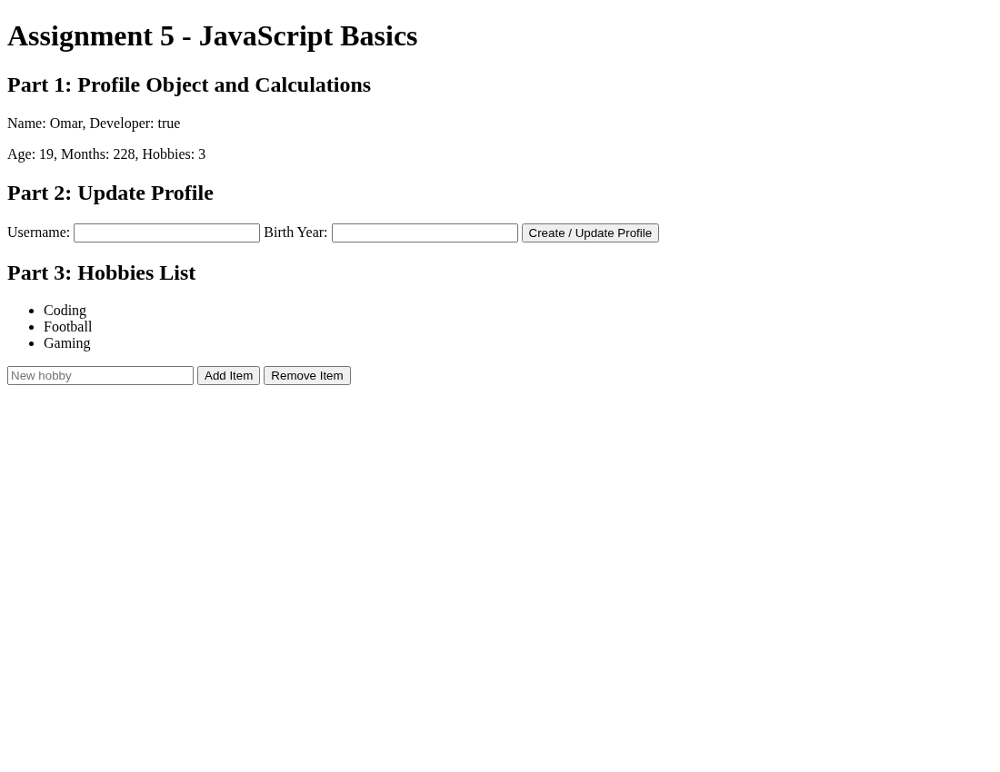
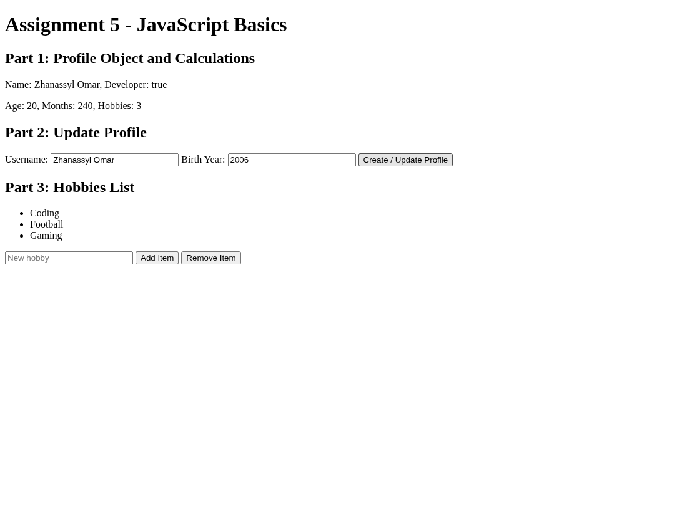
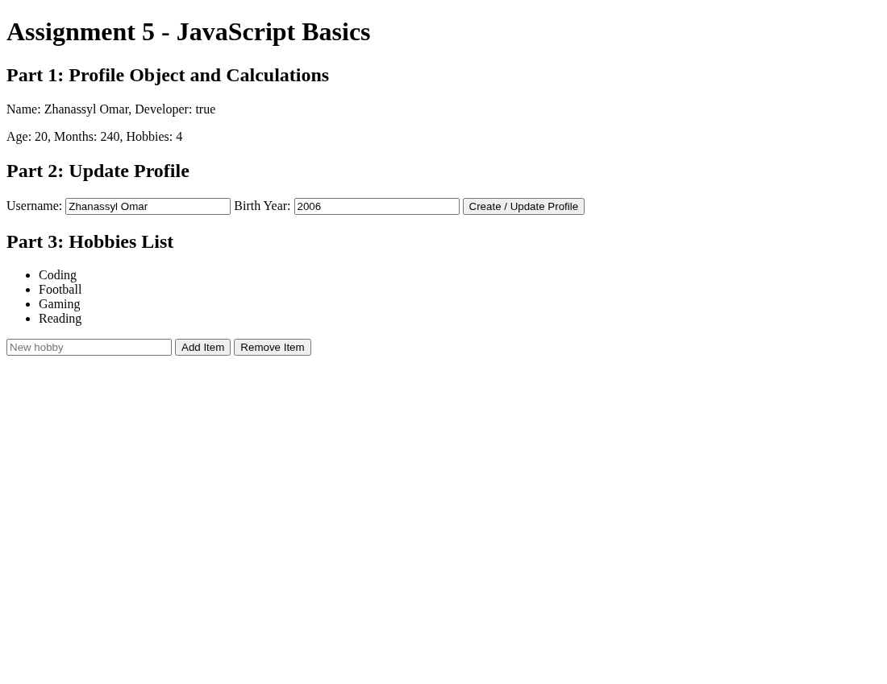

# Assignment 5 - JavaScript Basics

Name: Zhanassyl Omar  
Group: SE-2538

## Part 1: Profile Object, Data Types & Arithmetic

Task 1: Created `userProfile` with name, birth year, developer status, and hobbies.  
Task 2: Calculated age, age in months, and hobbies count using JavaScript.

## Part 2: Form Input & Event Responses

Task 3: Created a form with username, birth year, and submit button.  
Task 4: Used a submit event listener to update the profile with entered values.

## Part 3: DOM List Manipulation

Task 5: Displayed hobbies in an unordered list. The Add Item button adds a hobby and the Remove Item button removes the last one.

## Summary

I created a simple HTML page and connected a JavaScript file. I used an object, variables, arithmetic operations, DOM methods, and event listeners. I checked the form and tested adding and removing list items.
